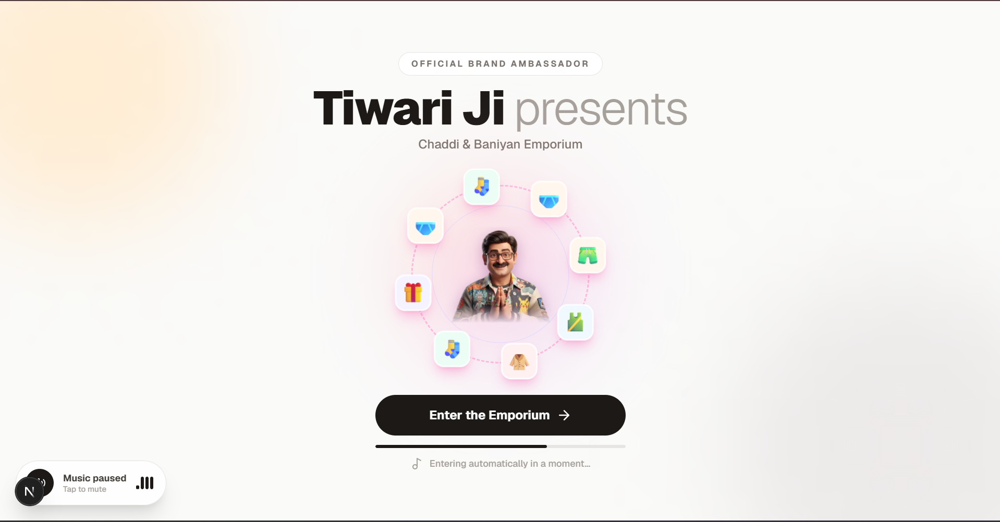
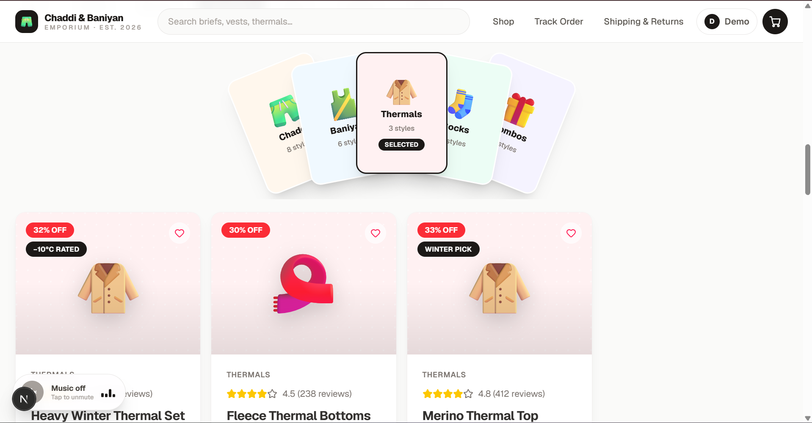

# Chaddi & Baniyan Emporium 🩳

A full-stack e-commerce store for everyday innerwear — briefs, boxers, baniyans,
thermals, socks and value combos. Built with **Next.js 16 (App Router)**,
**MongoDB + Mongoose**, **Tailwind CSS v4**, **shadcn/ui** conventions and
**Framer Motion**. Brand ambassador: **Tiwari Ji** ⭐

## Features

**Storefront**
- Splash screen with Tiwari Ji orbit animation (auto-dismisses in ~3.5s) + looping theme song with mute/unmute toggle
- Product grid with search, category filters (clickable fanned category deck), and sorting (price / rating / discount)
- Hover-reveal product cards with ratings, discount badges, stock states and size picker (S–XXL)
- Product details modal: reviews, size guide, delivery-pincode checker, ratings form
- Vertical marquee promo band, scroll-velocity marquee strip, sticky tile-reveal section, 3D hero text effects
- Cart drawer with sizes, quantities and free-shipping progress bar
- Testimonials, newsletter, shipping & returns info pages

**Ordering (dummy payments — no real money moves)**
- Guest or logged-in checkout: address step with pincode serviceability check → payment step (UPI / Card / COD, validated dummy gateway that returns a `TXN_…` ID)
- Atomic stock deduction in a MongoDB transaction (one out-of-stock item cancels the whole order)
- Order tracking timeline: PLACED → PACKED → SHIPPED → OUT_FOR_DELIVERY → DELIVERED, plus return requests

**Accounts & admin**
- JWT auth (httpOnly cookies) + bcrypt passwords; login / signup / logout
- Customer profile: saved address book, full order history
- Admin dashboard (`admin@chaddi.com`): revenue, order/user/product counts, orders-by-status, status updater, add-product form, low-stock alerts

## Screenshots

| Splash (auto-dismiss, Tiwari Ji orbit) | Shop grid (category deck + reveal cards) |
| -------------------------------------- | ---------------------------------------- |
|  |  |

> More shots (checkout, order tracking, admin dashboard, product modal) can be
> added to [`docs/screenshots/`](docs/screenshots/) — see its README for the
> filename convention.

## Tech stack

| Layer      | Choice                                                        |
| ---------- | ------------------------------------------------------------- |
| Framework  | Next.js 16.3.8 (App Router), React 19, TypeScript             |
| Styling    | Tailwind CSS v4, shadcn/ui (`components.json`, `@/components/ui`), `tw-animate-css` |
| Motion     | Framer Motion 14, `motion`                                    |
| Database   | MongoDB Atlas + Mongoose 9 (transactions for checkout)        |
| Auth       | `jsonwebtoken` (7-day JWT in httpOnly cookie) + `bcryptjs`    |
| Icons      | `lucide-react`                                                |

## Getting started

**Prerequisites:** Node.js 18+, npm, and a MongoDB connection string
(MongoDB Atlas free tier works).

```bash
# 1. Install dependencies
npm install

# 2. Configure environment (create this file)
# .env.local
MONGODB_URI="mongodb+srv://<user>:<password>@<cluster>/<db>?retryWrites=true&w=majority"
JWT_SECRET="any-long-random-string"

# 3. Run the dev server
npm run dev
```

Open [http://localhost:3000](http://localhost:3000).

> If `MONGODB_URI` / `JWT_SECRET` are missing, the app falls back to built-in
> dev defaults. **Rotate the MongoDB password and set real values before any
> public deployment** — the fallback URI contains a real credential.

**Seed the database** (dev only — inserts the 24-product catalog plus demo
accounts; never overwrites existing stock):

```bash
curl -X POST http://localhost:3000/api/seed
```

**Demo accounts** (password in code after seeding):

| Role     | Email               | Password    |
| -------- | ------------------- | ----------- |
| Admin    | `admin@chaddi.com`  | `admin123`  |
| Customer | `customer@demo.com` | `customer123` |

**Other scripts:** `npm run build` · `npm start` · `npm run lint` ·
`npx tsc --noEmit`

## Project structure

```
app/
  page.tsx                 # Storefront (home / account / admin / track / shipping views)
  layout.tsx               # Fonts, metadata, ShopProvider
  globals.css              # Theme tokens (stone/neutral light theme) + keyframes
  api/
    auth/{register,login,logout,me}/route.js
    products/route.js            # GET list · POST (admin: add product)
    products/[id]/route.js       # GET one · PATCH / DELETE (admin)
    products/[id]/reviews/route.js  # GET list · POST rate (auth)
    checkout/route.js            # Address + pincode validation, dummy payment, transactional order
    orders/route.js              # GET my past orders
    orders/[id]/route.js         # GET order detail
    orders/[id]/return/route.js  # POST return request
    account/addresses[/id]/route.js  # Address book CRUD
    admin/orders[/id]/route.js    # All orders · PATCH status
    admin/stats/route.js         # Revenue / counts / low stock
    pincode/route.js             # ?pincode= → serviceability + ETA
    seed/route.js                # Dev-only catalog + demo-account seeder
components/
  ui/                        # shadcn-style registry components
    button.tsx · product-reveal-card.tsx · promo-section.tsx
    letter-swap.tsx · text-reveal-3d.tsx · speeding-text.tsx
    tile-reveal.tsx · card-spread.tsx
  shop/                      # Store components (Header, AuthModal, ProductCard,
                             #  ProductModal, CartDrawer, CheckoutModal, OrdersPanel,
                             #  AdminPanel, AccountView, InfoPages, …)
  Splash.tsx · TiwariOrbit.tsx · MusicToggle.tsx · icons.tsx
lib/
  db.js                      # Connection cache + Product/User/Order/Review models
  auth.js · orders.js (normalizer) · pincode.js · shop-context.tsx
  catalog.ts (24 products) · types.ts · format.ts · utils.ts (cn)
public/tiwari/              # Brand-ambassador PNG + theme song
```

## API reference (selected)

All responses are JSON (`{ success, … }`). Authenticated routes read the
`ce_token` cookie (or `Authorization: Bearer`).

| Method & path                         | Auth    | Notes                                                        |
| ------------------------------------- | ------- | ------------------------------------------------------------ |
| `POST /api/auth/register`             | —       | `{name, email, password}` (min 6 chars)                      |
| `POST /api/auth/login` · `.../logout` · `GET .../me` | — | Cookie session                                         |
| `GET /api/products`                   | —       | `?category=` `?q=` filters                                   |
| `POST /api/products`                  | admin   | Add product (name, price, stock, sizes, …)                   |
| `PATCH`/`DELETE /api/products/[id]`  | admin   | Edit stock/price/details, delete                             |
| `GET`/`POST /api/products/[id]/reviews` | POST: login | 1–5 stars, one review per user, aggregate rating recomputed |
| `POST /api/checkout`                  | optional | `{items[{productId, quantity, size}], address, paymentMethod}` — validates pincode/phone, simulates gateway, commits transaction, returns `orderId` + `transactionId` |
| `GET /api/orders`                     | login   | Own order history (newest first)                             |
| `GET /api/orders/[id]`                | owner/admin | Detail + status history                                    |
| `POST /api/orders/[id]/return`        | owner   | `{reason}` — allowed after dispatch                          |
| `GET`/`POST /api/account/addresses`   | login   | Address book (pincode validated)                             |
| `GET /api/admin/orders?status=`       | admin   | All orders, optional status filter                           |
| `PATCH /api/admin/orders/[id]`        | admin   | `{status, note}`                                             |
| `GET /api/admin/stats`                | admin   | Revenue, counts, low-stock list                              |
| `GET /api/pincode?pincode=`           | —       | `{serviceable, etaDays, codAvailable}` (dummy rules)         |
| `POST /api/seed`                      | dev only | Upserts catalog + demo accounts                             |

**Data model (essentials):** `Product {name, price, mrp, stock, category,
description, rating, reviews, badge, emoji, sizes[], fabric}`,
`User {name, email, passwordHash, role, addresses[]}`,
`Order {userId, items[{productId, name, size, quantity, priceAtPurchase}],
subtotal, shipping, totalAmount, address, payment{method, transactionId,
status}, status, statusHistory[]}`,
`Review {productId, userId, rating, title, comment}` (unique per user+product).

## Development notes

- **Restart `npm run dev` after changing `lib/db.js` schemas.** Mongoose
  caches models per process (`mongoose.models`), so hot-reload keeps the old
  schema and silently strips new fields on write.
- **Next 16 route handlers:** `params` is a Promise — always
  `const { id } = await params` in `[id]` routes.
- **Checkout payments are simulated.** UPI/Card inputs are validated for shape
  only; ~3% of card/UPI attempts randomly fail to exercise the error path.
- **Pincode rules are dummy** (no external API): 6 digits, not starting with
  `0`; metros get 2–3 day ETA, others 3–6 days; COD unavailable for pincodes
  starting with `9`. Free shipping over ₹499, else ₹49.
- Product visuals are emoji tiles, not photos — zero broken-image risk and no
  external image dependencies.

## Deploying

Set `MONGODB_URI` and `JWT_SECRET` in your host's environment variables, then:

```bash
npm run build && npm start
```

`/api/seed` refuses to run with `NODE_ENV=production`, so seed from a local
dev server pointing at the same database (or insert products via the admin
dashboard's add-product form after deploying).
